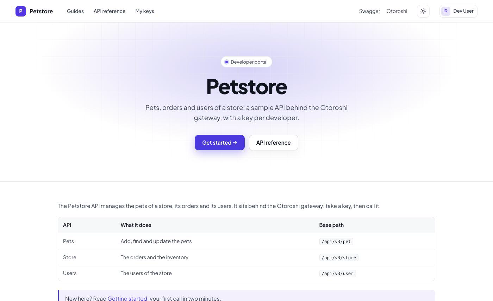
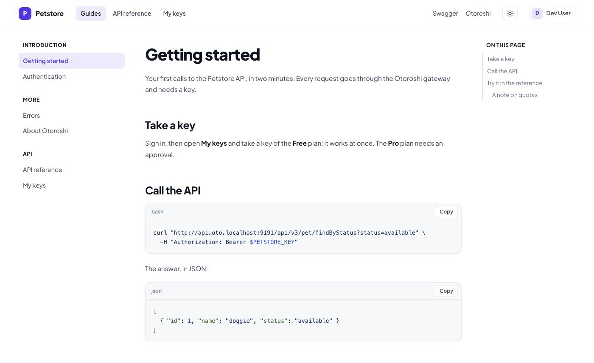
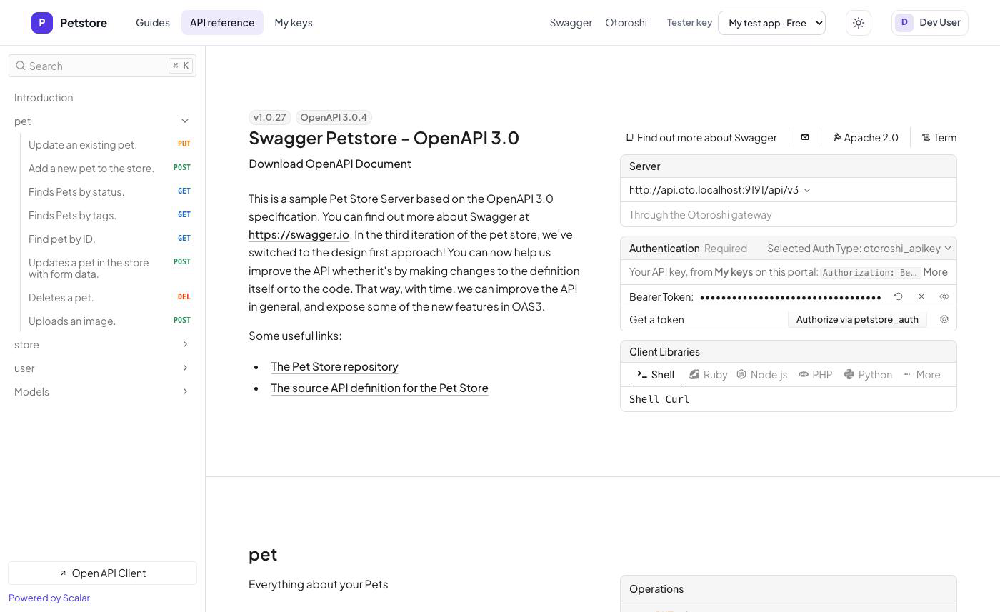
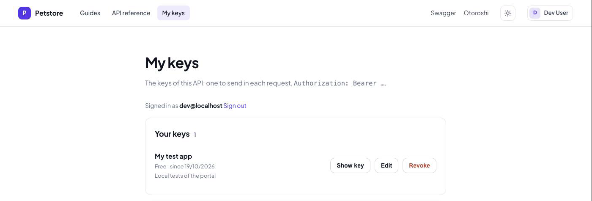

# Otoroshi API Portal

A lightweight, self-contained developer portal plugin for [Otoroshi](https://www.otoroshi.io/). It turns any Otoroshi API into a full-featured portal with documentation rendering, an interactive API reference you can try requests from, and self-service API keys -- all without deploying a separate frontend application. It has the look and the features of the developer portals of [Cloud APIM Serverless](https://www.cloud-apim.com/).

## Why use it?

If you expose APIs through Otoroshi and need a developer-facing portal, you typically have two options: build a custom frontend or integrate a heavy third-party solution. This plugin offers a third path:

- **Zero infrastructure** -- the portal is served directly by Otoroshi as a backend plugin. No extra server, no Node.js app, no static hosting to manage.
- **Configuration-driven** -- everything (pages, navigation, OpenAPI specs, subscription plans) is declared in the API's `documentation` JSON section. Update the config, the portal updates instantly.
- **Self-service subscriptions** -- authenticated users can subscribe to published plans, get API keys, and start calling your API immediately. Plans support auto-validation or manual approval workflows.
- **Try it from the reference** -- developers pick one of their keys in the top bar and send requests from the API reference ([Scalar](https://github.com/scalar/scalar)), through the Otoroshi gateway, without leaving the browser.
- **Dark mode, responsive, modern UI** -- a clean, fast interface (no CSS framework, no build) that works on desktop and mobile out of the box.

## Features

- Home page: a hero with the name and the pitch of the API, its HTML or Markdown content, cards for its specifications, its plans and its guides
- Documentation pages with a sidebar (categories and links), an "On this page" table of contents, previous / next links
- Markdown rendering (via [marked](https://marked.js.org/)), code highlighting (via [highlight.js](https://highlightjs.org/)) with a copy button, heading anchors
- API reference (via [Scalar](https://github.com/scalar/scalar)), one or several specifications (JSON or YAML)
- Try it: requests sent from the reference through the portal (no CORS), to the hosts of the API only, with the key of the developer
- The gateway of the API added as the first server of the specifications, the API keys of the developers as their security scheme
- Self-service API keys: take a key of a plan, show it, rename it, disable it, revoke it; plans validated by hand wait for an approval (confirmed in Otoroshi)
- Remote content loading (documentation pages and resources fetched from URLs)
- Remote portal configuration (load the entire `documentation` section from a URL)
- Redirections, banner, footer, links in the top bar
- Light / Dark / System theme, an accent color
- Authentication integration via Otoroshi auth modules
- Otoroshi cluster support (leader/worker mode)

## Screenshots

### Home



### Documentation



### OpenAPI reference



### My keys



## Installation

1. Download the latest JAR from the [releases page](https://github.com/cloud-apim/otoroshi-api-portal/releases)
2. Add the JAR to your Otoroshi plugins directory (see [Otoroshi documentation](https://maif.github.io/otoroshi/manual/plugins/index.html) on loading external plugins)
3. Restart Otoroshi -- the plugin `Otoroshi API Portal` will appear in the available plugins list

## Setup

Using the portal requires two things: an **API** with a `documentation` section, and a **Route** that serves the portal.

### 1. Configure your API documentation

In the Otoroshi admin, create or edit an API (`apis.otoroshi.io/Api`). Add a `documentation` section to it, and the plans developers take keys of. Here is a minimal example:

```json
{
  "documentation": {
    "enabled": true,
    "home": {
      "path": "/home",
      "content_type": "text/html",
      "site_page": true,
      "transform": "markdown",
      "text_content": "# Welcome\n\nThis is my API portal."
    },
    "logo": {
      "url": "https://example.com/logo.png",
      "path": "/favicon.png",
      "content_type": "image/png"
    },
    "references": [
      {
        "title": "My API",
        "link": "/openapi.json"
      }
    ],
    "resources": [
      {
        "title": "My API",
        "path": "/openapi.json",
        "content_type": "application/json",
        "url": "https://example.com/openapi.json"
      }
    ],
    "navigation": [
      {
        "label": "Documentation",
        "icon": { "css_icon_class": "bi bi-journal-text me-2" },
        "path": "/documentation",
        "items": [
          {
            "label": "API",
            "kind": "category",
            "links": [
              {
                "label": "API Reference",
                "link": "/api-references",
                "icon": { "css_icon_class": "bi bi-braces me-2" }
              }
            ]
          }
        ]
      }
    ],
    "redirections": [],
    "search": { "enabled": true },
    "metadata": {
      "portal.accent": "#4f46e5"
    },
    "tags": []
  },
  "plans": [
    {
      "id": "free",
      "name": "Free",
      "description": "A free plan to try the API",
      "access_mode_configuration_type": "apikey",
      "access_mode_configuration": {},
      "rate_limiting": {
        "strategy": {
          "id": "LegacyThrottlingStrategyConfig",
          "quota": { "window": 10, "daily": 100, "monthly": 1000 }
        }
      },
      "validation": { "kind": "auto" },
      "status": "published",
      "tags": [],
      "metadata": {}
    }
  ]
}
```

### 2. Create the portal route

Create an Otoroshi Route (`proxy.otoroshi.io/Route`) that will serve the portal. The route needs the following plugin chain:

```json
{
  "frontend": {
    "domains": ["portal.example.com"],
    "strip_path": true,
    "exact": false
  },
  "backend": {
    "targets": [
      {
        "hostname": "request.otoroshi.io",
        "port": 443,
        "tls": true
      }
    ]
  },
  "plugins": [
    {
      "plugin": "cp:otoroshi.next.plugins.OverrideHost",
      "enabled": true,
      "config": {}
    },
    {
      "plugin": "cp:otoroshi.next.plugins.NgAuthModuleUserExtractor",
      "enabled": true,
      "config": {
        "module": "<your-auth-module-id>"
      }
    },
    {
      "plugin": "cp:otoroshi.next.plugins.AuthModule",
      "enabled": true,
      "include": ["/login"],
      "config": {
        "module": "<your-auth-module-id>"
      }
    },
    {
      "plugin": "cp:otoroshi_plugins.com.cloud.apim.plugins.apiportal.OtoroshiApiPortal",
      "enabled": true,
      "config": {
        "api_ref": "<your-api-id>"
      }
    }
  ]
}
```

The plugins serve different roles:

| Plugin | Role |
|---|---|
| `OverrideHost` | Rewrites the Host header for the backend target |
| `NgAuthModuleUserExtractor` | Extracts the authenticated user on every request (without blocking). This allows the portal to show/hide subscription features based on login state |
| `AuthModule` (include: `/login`) | Forces authentication **only** on the `/login` path. The portal remains publicly browsable; users log in explicitly to manage their keys |
| `OtoroshiApiPortal` | The portal plugin itself |

### Plugin configuration

| Field | Type | Description |
|---|---|---|
| `api_ref` | `string` | **Required**. The ID of the Otoroshi API whose documentation will be rendered |
| `prefix` | `string` | Optional path prefix if the portal is not served at the root of the domain (e.g. `/portal`) |

## Documentation format reference

The `documentation` section of the API is a JSON object with the following fields:

### Top-level fields

| Field | Type | Description |
|---|---|---|
| `enabled` | `boolean` | Enable or disable the portal |
| `source` | `object \| null` | Load the entire documentation config from a remote URL. When set, the `url` field inside must point to a JSON file matching this schema. Useful for managing portal config in a git repository |
| `home` | `resource` | The home page resource (displayed at `/`) |
| `logo` | `resource` | The portal logo/favicon resource |
| `references` | `reference[]` | List of OpenAPI specifications to expose |
| `resources` | `resource[]` | All servable resources (pages, specs, images, etc.) |
| `navigation` | `sidebar[]` | Top-level navigation tabs, each containing a sidebar with categories and links |
| `redirections` | `redirection[]` | URL redirections |
| `search` | `object` | Search configuration (`{ "enabled": true }`), not used yet |
| `footer` | `resource \| null` | The text of the footer: its `text_content` (HTML when its `content_type` is `text/html`). The name of the portal by default |
| `banner` | `resource \| null` | A notice above the top bar: its `text_content` (HTML when its `content_type` is `text/html`) |
| `metadata` | `object` | The settings of the portal (see below), and any key-value metadata |
| `tags` | `string[]` | Tags |

The plans developers take keys of are the `plans` of the API itself (see [Plan](#plan)).

### Portal settings

The look of the portal is set in the `metadata` of the documentation, all optional:

| Key | Default | Description |
|---|---|---|
| `portal.title` | the name of the API | The name of the portal, in the top bar and the home |
| `portal.description` | the description of the API | The pitch of the home |
| `portal.theme` | `system` | `system`, `light` or `dark` |
| `portal.toggle` | `true` | `false` hides the light / dark button (and locks a `light` or `dark` theme) |
| `portal.accent` | `#0061bd` | The accent color, like `#4f46e5` |
| `portal.links` | none | Links of the top bar, a JSON array as a string: `[{"label": "Status", "url": "https://status.example.com"}]` |
| `portal.reference.theme` | `default` | The theme of the reference (Scalar): `default`, `alternate`, `moon`, `purple`, `solarized`, `bluePlanet`, `deepSpace`, `saturn`, `kepler`, `mars`, `laserwave`, `elysiajs`, `fastify`, `none` |
| `portal.reference.layout` | `modern` | `modern` or `classic` |
| `portal.reference.client` | `true` | `false` hides the client (the *Test Request* buttons) |
| `portal.reference.models` | `true` | `false` hides the models |
| `portal.reference.gateway_server` | `true` | `false` keeps only the servers of the specifications (see [API reference](#api-reference-and-try-it)) |
| `portal.keys.per_user` | unlimited | How many keys a developer can take |

### Remote source

You can host your entire documentation configuration as a JSON file and load it remotely:

```json
{
  "documentation": {
    "enabled": true,
    "source": {
      "url": "https://raw.githubusercontent.com/my-org/my-api/main/portal.config.json"
    }
  }
}
```

The remote JSON file must follow the same documentation schema. This is useful for managing your portal configuration in version control alongside your API code.

### Resource

A resource represents any servable content: a page, an image, a JSON file, etc.

| Field | Type | Description |
|---|---|---|
| `path` | `string` | The URL path where this resource is served (e.g. `/documentation/getting-started`) |
| `title` | `string` | Optional display title |
| `content_type` | `string` | MIME type (`text/html`, `text/markdown`, `application/json`, `image/png`, etc.) |
| `site_page` | `boolean` | If `true`, the resource is rendered inside the portal layout (header, sidebar, etc.). If `false` or absent, it is served raw |
| `text_content` | `string` | Inline text content (HTML, Markdown, etc.) |
| `url` | `string` | Fetch the content from this URL at render time. Takes precedence over `text_content` |
| `base64_content` | `string` | Base64-encoded binary content (for images, etc.) |
| `json_content` | `object` | Inline JSON content |
| `transform` | `string` | `"markdown"` renders the content as Markdown (a `text/markdown` content type does too); `"scalar"` (or `"redoc"`) renders a page with the content as an OpenAPI specification in the API reference |
| `transform_wrapper` | `string` | HTML wrapper around Markdown content. Use `{content}` as a placeholder (e.g. `<div class="callout">{content}</div>`) |
| `description` | `string` | Optional summary of a page, on its card in the home (the first paragraph of an inline Markdown page by default) |
| `http_headers` | `object` | Headers sent when the content is fetched from `url` (never shown on the portal) |

Content resolution priority: `url` > `base64_content` > `json_content` > `text_content`.

A page whose `url` answers an error is shown with a short notice instead of its content.

### Reference

A reference points to an OpenAPI specification that will be rendered with Scalar in the API reference section.

| Field | Type | Description |
|---|---|---|
| `title` | `string` | Display name of the specification |
| `link` | `string` | Path to the corresponding resource (e.g. `/openapi.json`), a JSON or YAML specification. Must match a resource's `path`, or be an `https://` address |
| `description` | `string` | Optional description shown on the reference selection page |
| `icon` | `object` | Optional icon (`{ "css_icon_class": "bi bi-rocket" }`) |

If you have a single reference, the API reference page shows the spec directly. With multiple references, a selection page is displayed first.

### API reference and Try it

The reference is rendered with [Scalar](https://github.com/scalar/scalar), with the client of Scalar to send requests from the portal. The specification it reads (`/api/openapi?link=<link>`) is the one of the reference, with:

- **the gateway of the API as its first server**: `<scheme>://<domain of the API><context path of the API>`, with the scheme and the port the portal is read with (the servers of the specification follow, their relative addresses made absolute). Turn it off with `portal.reference.gateway_server: false`
- **the keys of the developers as its security scheme**, when the API has `apikey` plans: `otoroshi_apikey`, a bearer token (`Authorization: Bearer <key>`), required by the specification and offered on the operations that ask for their own security

A signed in developer picks one of their keys in the top bar (*Tester key*): it is put in the authentication of the reference, for this tab only.

The requests sent from the reference go through the portal (`/api/_proxy`, the `proxyUrl` of Scalar), so the browser needs no CORS from the API. The portal only sends them to the hosts of the API: the domain of the API and the servers of its specifications. It never sends the cookies of the portal.

### Navigation (sidebar)

Navigation entries appear as tabs in the top navigation bar. Each entry contains a sidebar with categories and links for its section.

```json
{
  "label": "Documentation",
  "icon": { "css_icon_class": "bi bi-journal-text me-2" },
  "path": "/documentation",
  "items": [
    {
      "label": "Guides",
      "kind": "category",
      "links": [
        {
          "label": "Getting started",
          "link": "/documentation/getting-started",
          "icon": { "css_icon_class": "bi bi-book me-2" }
        }
      ]
    },
    {
      "label": "FAQ",
      "link": "/documentation/faq",
      "icon": { "css_icon_class": "bi bi-question-circle me-2" }
    }
  ]
}
```

Items can be either **categories** (with `"kind": "category"` and a `links` array) or **direct links** (with a `link` field). Icons use [Bootstrap Icons](https://icons.getbootstrap.com/) CSS classes.

### Plan

Plans define the subscription options available to authenticated users.

| Field | Type | Description |
|---|---|---|
| `id` | `string` | Unique identifier for the plan |
| `name` | `string` | Display name |
| `description` | `string` | Description shown to users when choosing a plan |
| `access_mode_configuration_type` | `string` | Type of access: `"apikey"` for API key-based access (`keyless`, `jwt`, `mtls`, `oauth2-*` plans are shown, no key is taken of them) |
| `access_mode_configuration` | `object` | The settings of the keys of the plan (name pattern, restrictions, ...) |
| `rate_limiting` | `object` | The quotas of the keys: `{ "strategy": { "id": "LegacyThrottlingStrategyConfig", "quota": { "window": 10, "daily": 1000, "monthly": 10000 } } }` |
| `validation` | `object` | `{ "kind": "auto" }` (a key at once) or `{ "kind": "manual" }` (the key waits for an approval) |
| `visibility` | `object` | `{ "kind": "private" }` hides the plan from the portal |
| `status` | `string` | `"published"` to make the plan available, any other value hides it |
| `tags` | `string[]` | Tags applied to generated API keys |
| `metadata` | `object` | Metadata applied to generated API keys |

The published plans are shown on the home, with their quotas. Plans with `access_mode_configuration_type: "apikey"` enable the **My keys** page.

### API keys

A signed in developer takes a key of a plan in **My keys**: the portal creates a subscription to the plan (`apis.otoroshi.io/ApiSubscription`, owned by the email of the developer), and Otoroshi creates its API key from the plan (its quotas, its tags, its metadata). With an `auto` plan, the key works at once and the portal shows it. With a `manual` plan, the subscription is `pending` and its key disabled until the subscription is confirmed in Otoroshi.

The developer then shows a key again, renames it, disables it, or revokes it (its subscription and its key deleted). They only ever see and change their own keys.

### Redirection

```json
{
  "from": "/old-path",
  "to": "/new-path"
}
```

A `/logout` -> `/.well-known/otoroshi/logout` redirection is always added automatically.

## Full example

Here is a complete documentation section for a Wine API portal with multiple documentation pages and a single OpenAPI spec (the plans are the ones of the API):

```json
{
  "enabled": true,
  "home": {
    "path": "/home",
    "content_type": "text/html",
    "site_page": true,
    "transform": "markdown",
    "transform_wrapper": "<div class=\"container-xxl\" style=\"margin-top: 30px;\">{content}</div>",
    "text_content": "<div class=\"container-xxl\" style=\"margin-top: 30px;\">\n\n# Welcome to the Wine API\n\nThe **Wine API** gives you access to a rich catalog of wines, grape varieties, wineries, and wine regions.\n\n## Getting Started\n\n1. **Sign up** for an API key on this portal.\n2. **Check out the documentation** to learn about available endpoints.\n3. **Start querying**:\n\n   ```bash\n   curl https://wines-api.example.com/api/wines?region=Bordeaux\n   ```\n\nGo to the [documentation](/documentation) for more details.\n</div>\n"
  },
  "logo": {
    "url": "https://example.com/wine-logo.png",
    "path": "/favicon.png",
    "content_type": "image/png"
  },
  "references": [
    {
      "title": "Wines API",
      "link": "/openapi.json"
    }
  ],
  "resources": [
    {
      "title": "Wines API",
      "path": "/openapi.json",
      "content_type": "application/json",
      "url": "https://wines-api.example.com/docs/openapi.json"
    },
    {
      "path": "/documentation/getting-started",
      "content_type": "text/html",
      "site_page": true,
      "transform": "markdown",
      "url": "https://raw.githubusercontent.com/my-org/wines-api/main/docs/getting-started.md"
    },
    {
      "path": "/documentation/latency",
      "content_type": "text/markdown",
      "site_page": true,
      "transform": "markdown",
      "url": "https://raw.githubusercontent.com/my-org/wines-api/main/docs/latency.md"
    },
    {
      "path": "/docs/architecture.png",
      "content_type": "image/png",
      "url": "https://raw.githubusercontent.com/my-org/wines-api/main/docs/architecture.png"
    }
  ],
  "navigation": [
    {
      "label": "Documentation",
      "icon": { "css_icon_class": "bi bi-journal-text me-2" },
      "path": "/documentation",
      "items": [
        {
          "label": "Guides",
          "kind": "category",
          "links": [
            {
              "label": "Getting started",
              "link": "/documentation/getting-started",
              "icon": { "css_icon_class": "bi bi-book me-2" }
            },
            {
              "label": "Latency",
              "link": "/documentation/latency",
              "icon": { "css_icon_class": "bi bi-speedometer2 me-2" }
            }
          ]
        },
        {
          "label": "API",
          "kind": "category",
          "links": [
            {
              "label": "API Reference",
              "link": "/api-references",
              "icon": { "css_icon_class": "bi bi-braces me-2" }
            }
          ]
        }
      ]
    }
  ],
  "redirections": [
    { "from": "/docs", "to": "/documentation" }
  ],
  "search": { "enabled": true },
  "footer": { "content_type": "text/plain", "text_content": "Wine API · data from the open wine catalog" },
  "banner": null,
  "metadata": {
    "portal.accent": "#7c2d12",
    "portal.links": "[{\"label\": \"Status\", \"url\": \"https://status.wines-api.example.com\"}]"
  },
  "tags": []
}
```

## Portal routes

The portal exposes the following routes internally:

| Method | Path | Description |
|---|---|---|
| `GET` | `/` | Home page |
| `GET` | `/login?redirect=<path>` | Triggers authentication (redirects to auth module), then back to `<path>` |
| `GET` | `/logout` | Logs out (redirected to Otoroshi logout) |
| `GET` | `/api-references` | API reference page (or spec selection if multiple) |
| `GET` | `/api-references/<spec-path>` | The API reference of one spec |
| `GET` | `/keys` | The keys of the developer (`/subscriptions` redirects there) |
| `GET` | `/_portal/<file>` | The files of the portal (`portal.css`, `portal.js`, `theme.js`) |
| `GET` | `/<resource-path>` | Any resource defined in the documentation |
| `GET` | `/api/session` | JSON: the signed in developer, the plans they take keys of |
| `GET` | `/api/plans` | JSON list of the plans shown on the portal |
| `GET` | `/api/documentation` | JSON documentation metadata |
| `GET` | `/api/openapi?link=<link>` | A specification, as the reference reads it (gateway server, security scheme) |
| `GET` | `/api/apikeys` | JSON list of the keys of the developer (never their secrets) |
| `POST` | `/api/apikeys` | Take a key: `{ "name", "description", "plan" }` |
| `POST` | `/api/apikeys/<id>/reveal` | The bearer token of a key |
| `PUT` | `/api/apikeys/<id>` | Update a key: `{ "name", "description", "enabled" }` |
| `DELETE` | `/api/apikeys/<id>` | Revoke a key |
| any | `/api/_proxy?scalar_url=<url>` | The requests of the reference, to the hosts of the API only |

`<id>` is the id of the subscription of the key (or the client id of its API key). The writes need a signed in developer and the `X-Otoroshi-Api-Portal: 1` header (sent by the pages of the portal, never by a foreign form).

The pages load [Scalar](https://github.com/scalar/scalar), [marked](https://marked.js.org/) and [highlight.js](https://highlightjs.org/) from jsDelivr, at fixed versions, and the Plus Jakarta Sans font from Google Fonts.

## License

[Apache 2.0](./LICENSE) -- Copyright 2023-2025 [Cloud APIM](https://www.cloud-apim.com/)
